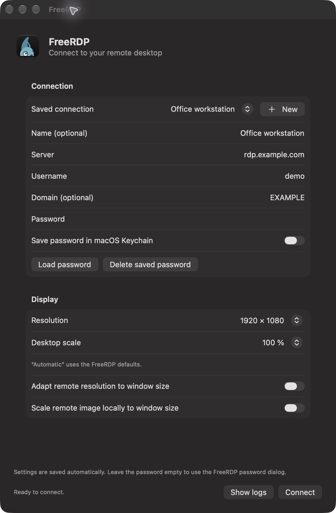

# FreeRDP Launcher for macOS

- Native connection window; self-contained SDL3 FreeRDP app.
- Deutsch/English; automatic system language, with an override in FreeRDP → Language; macOS light/dark appearance.
- Saved connection profiles with optional names and domains; optional local Keychain password storage; password passed via stdin.
- In-memory colored logs: **Command-Shift-L**; resizable, scrollable, no line wrapping.

## Build

- Requirements: macOS 13+, native Apple Silicon or Intel, Xcode command-line tools.
- Install tools manually: `xcode-select --install` and `brew install cmake ninja pkgconf`.
- Run `./build.sh` from this repository; no external dependency prefix is needed.
- Optional overrides: copy `.env.example` to `.env`; set `FREERDP_REPOSITORY`, `FREERDP_BRANCH` and optionally `FREERDP_COMMIT`.
- Shell environment overrides `.env`; `.env` values are literal, without shell expansion.
- Default FreeRDP source: upstream `https://github.com/FreeRDP/FreeRDP.git`, branch `master`, without a commit pin; the first native build resolves the branch and records the exact revision. `FREERDP_COMMIT` can pin a revision.
- Optional local checkout: `FREERDP_SOURCE=/path/to/clean/FreeRDP ./build.sh`.
- Optional build settings: `JOBS=8`, `ARCH=arm64` or `x86_64` (native only), `MACOSX_DEPLOYMENT_TARGET=13.0`.
- The first build downloads verified sources and builds all third-party libraries; it never installs packages.
- Subsequent builds reuse dependencies and FreeRDP, compile the GUI and refresh/sign the app bundle.
- Missing or modified native products/notices, or changed native build settings, sources or toolchain trigger a clean native rebuild; cached archives remain available.
- Force a native rebuild (and refresh an unpinned FreeRDP branch): `./build.sh --rebuild-native`.
- Keep `build/cache` and `build/sources` for source verification, notices and release packaging; do not edit cached sources.
- Output: `build/FreeRDP.app`; CLI wrapper: `build/bin/sdl-freerdp`.
- Copy the app to `~/Applications` or `/Applications` for Spotlight; no source checkout or Homebrew runtime libraries are required.
- Native code uses Release optimization and LTO where supported; verbose WinPR runtime assertions are disabled.
- Local builds use ad-hoc signing. Official GitHub releases require Apple Developer ID signing, notarization and stapling.

## Dependencies

- Source-built shared libraries: FreeRDP/WinPR, OpenSSL, zlib, FreeType, HarfBuzz, SDL3, SDL_ttf, FFmpeg.
- FFmpeg: H.264 decoding/parser; AAC, MP3, Opus, PCM and ADPCM audio; scaling/resampling.
- No FFmpeg programs, networking, containers, filters, external codec libraries, GPL or nonfree features.
- H.264 encoding/webcam compression and less common audio codecs are intentionally omitted.
- FFmpeg is optional: `WITH_FFMPEG=OFF ./build.sh` uses native VideoToolbox when supported by the selected FreeRDP revision; AAC/Opus audio, resampling and FFmpeg scaling are then unavailable.
- macOS frameworks and system libraries remain system-provided.

## Releases

- Commit changes and push a semantic version tag, e.g. `v0.1.0`.
- `.github/workflows/release.yml` uses `https://github.com/jb-alvarado/FreeRDP.git`, branch `integration/sdl3-macos-fixes`; it resolves the branch once so Apple Silicon and Intel build the same commit, then publishes both variants together.
- Local packaging (ad-hoc, not notarized): `RELEASE_VERSION=v0.1.0 ./build.sh --release` from a clean checkout.
- Assets: compressed app DMG (with an Applications shortcut), matching complete source archive and SHA-256 checksums for each architecture.
- Source archives include exact dependency sources, the FreeRDP revision, launcher sources, licenses and build configuration.
- Keep source assets available alongside binaries; see [third-party notices](THIRD_PARTY_NOTICES.md).
- Build configuration changes or a custom FreeRDP fork can introduce additional license obligations.

## Development

- Python checks: `python3 -m unittest discover -s Tests -p 'test_*.py' -v`.
- Launcher model checks: [Tests/README.md](Tests/README.md).
- Existing connection settings migrate automatically to the first profile; names fall back to the server address.
- Each profile saves its connection/display settings; switching profiles clears the password field.
- Keychain accounts include server, username and optional domain; passwords are never stored in profiles.
- Automatic resolution/scale use FreeRDP defaults.
- Logs stay in RAM; buffer limits: `Resources/LauncherConfig.json`.
- Settings and Keychain items live outside the bundle and survive app replacement.

## License

- Launcher/build tooling: [Apache-2.0](LICENSE).
- Dependencies/fonts retain their own licenses; see [THIRD_PARTY_NOTICES.md](THIRD_PARTY_NOTICES.md).
- FFmpeg uses LGPL-2.1-or-later; shared-library replacement: [RELINKING.md](docs/RELINKING.md).
- Corresponding-source rebuild instructions: [REBUILDING.md](docs/REBUILDING.md).
